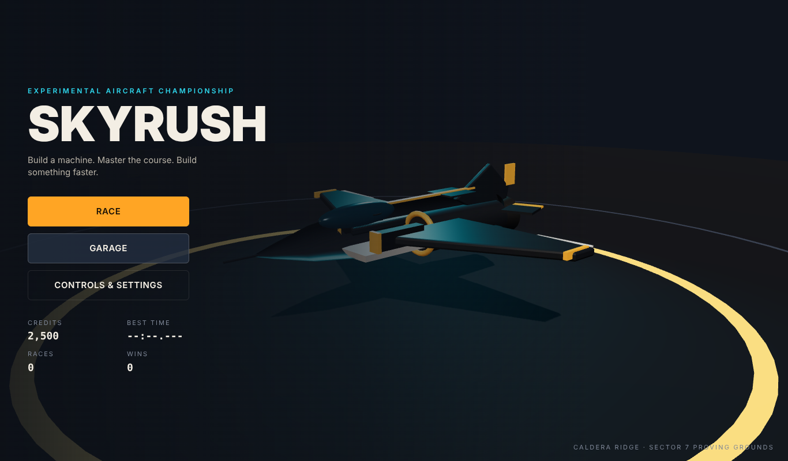
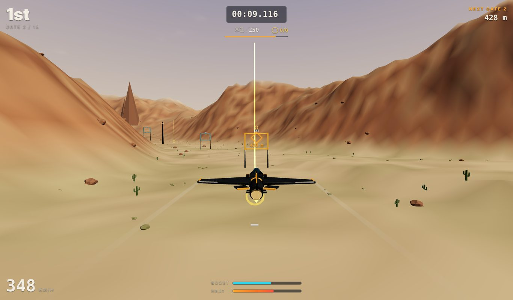
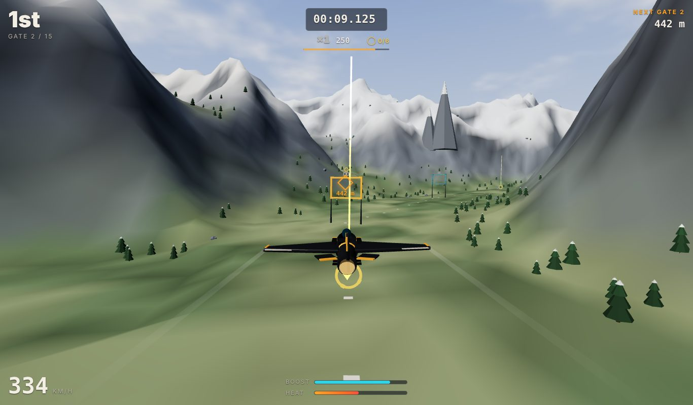
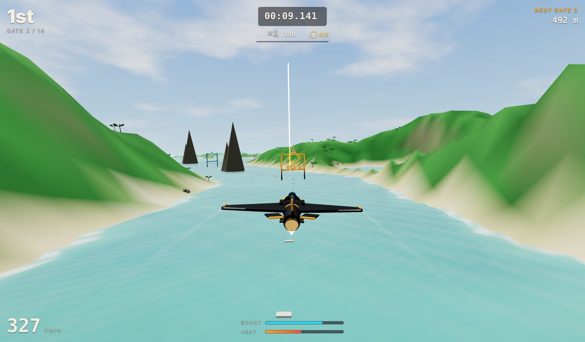
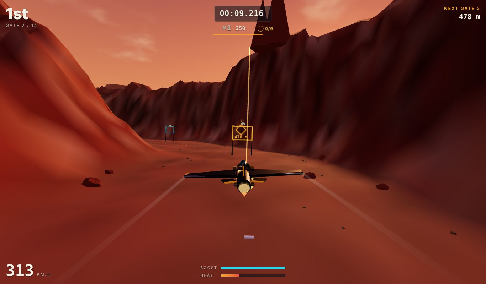

# SKYRUSH

**Collect the aircraft. Tune every part. Then race it, fly the shows, run the mail and explore.**

SKYRUSH is a browser game about building up a hangar of distinctive propeller aircraft (a nimble
scout, a sport two-seater, a long-nosed racer, a strutted bush plane, a floatplane and a twin-engined
cruiser), tuning each one part by part, and flying them flat out through four gated courses against
three AI pilots. It runs on desktop browsers and on iPhone Safari in
landscape, needs no account or backend, and deploys as a static site to GitHub Pages.



## Playing

| Screen    | What happens                                                                                                     |
| --------- | ---------------------------------------------------------------------------------------------------------------- |
| Main menu | The aircraft you fly, course picker (‹ ›), credits, best time. Race, Hangar, or Controls & Settings.             |
| Hangar    | Choose an aircraft, preview and fit parts in six slots, paint it, save setups; compare everything before buying. |
| Briefing  | All four courses to choose from, course facts, opponents, control bindings, assistance and sensitivity.          |
| Race      | 3-2-1 countdown, 14–15 gates, live position, timer, boost and heat, next-gate marker.                            |
| Results   | Finishing position, time with penalties, reward breakdown, standings, newly unlocked parts. Race again or tune.  |

### Courses

Every course is open from the start, keeps its own best time, and has its own landscape, light and
props. The selected course is remembered between sessions.

| Course         | Character | Setting                                                                                                | Par  |
| -------------- | --------- | ------------------------------------------------------------------------------------------------------ | ---- |
| Caldera Ridge  | Balanced  | Desert canyon at golden hour: a flat-out straight, a climb over the ridge, the Needle chicane.         | 1:45 |
| Frostline Pass | Climbing  | Alpine valleys under snowbound peaks and pine forest, up to the High Pass gate at 370 m and back down. | 1:44 |
| Coral Coast    | Fast      | Low over turquoise water between jungle islands and sea stacks, with a hop over the Saddle ridge.      | 1:43 |
| Ember Mesa     | Technical | Terraced red mesas at dusk, a chicane under the Ember Arch and a hop across a mesa top.                | 1:40 |

|  |  |
| ----------------------------------------------------------- | ------------------------------------------------------------- |
|      |          |

On Coral Coast the water counts as ground: skimming it is a scrape, diving into it a crash.

### Controls

**Desktop**

| Key                 | Action                |
| ------------------- | --------------------- |
| `W` / `↑`           | Nose up (climb)       |
| `S` / `↓`           | Nose down (dive)      |
| `A` `D` / `←` `→`   | Roll left / right     |
| `Q` / `E`           | Yaw left / right      |
| `Shift` (hold)      | Boost                 |
| `Space` (hold)      | Airbrake              |
| `X` / `Ctrl` (hold) | Ease off the throttle |
| `C`                 | Recenter camera       |
| `R`                 | Restart race          |
| `M`                 | Sound on / off        |
| `Esc` / `P`         | Pause / resume        |

**iPhone (landscape)**: left virtual stick (left/right banks and turns, up/down pitches), throttle
slider, BOOST and BRAKE hold buttons, and a pause button. Pitch direction can be inverted in settings
on both devices.

With assistance above 0% (the default is 60%), left and right command a bank angle capped at about
72° and the banked aircraft turns by itself, so it can never be rolled inverted; the nose is kept
within about 57° so it cannot loop. Set assistance to 0% for raw rate control on every axis.

### Style, combos and rings

Racing is scored on time and position as before. On top of that, skilful flying earns **style points**:

| Move         | Base points | Extra                                                                                   |
| ------------ | ----------- | --------------------------------------------------------------------------------------- |
| Clean gate   | 100         | Keeps the combo alive                                                                   |
| Perfect gate | 250         | Through the centre ~38% of the gate; +12% boost                                         |
| Near miss    | 150–400     | Skim terrain within 9 m at speed and climb out; closer and longer pays more; +8% boost  |
| Bonus ring   | 300         | Six gold rings sit low over the valley floor, 40–60 m below the racing line; +25% boost |
| Overtake     | 200         | Once per opponent every 12 s                                                            |

Perfect gates, near misses, rings and overtakes grow the chain; every two moves add ×0.5 to the
multiplier (up to ×4). A missed gate, scrape, crash, going out of bounds or 10 s without a gate or move
breaks the chain. Near misses need the aircraft to come down from above 15 m, pay once on climbing out,
never pay if the ground was touched, and have a 2.5 s cooldown, so they cannot be farmed. Style pays up
to +500 credits per race (score ÷ 25).

**Badges** each unlock a paint colour and a livery theme with a matching contrail: Ring Runner (all six
rings in a race → Aurora Mint), Bullseye (8 perfect gates → Solar Gold), Canyon Skimmer (6 near misses →
Dune Copper) and Combo King (reach ×4 → Neon Rose). A 3,000-point style run also unlocks the Scimitar
racing propeller. The results screen shows the run's highlights and
progress toward the closest unearned badge.

Returning players go straight from **Race** on the menu to the grid (the briefing is shown before the
first race and is always reachable from the garage). **Race again** sits at the top of the results;
`Enter` also replays.

### Flight board and activities

**Flight board** on the main menu lists everything there is to fly in the selected region, set like a
departures board. Each region holds five activities:

| Activity    | What you do                                                                                                           | Medals on                |
| ----------- | --------------------------------------------------------------------------------------------------------------------- | ------------------------ |
| Grand Prix  | The original four-aircraft race.                                                                                      | (credits, badges)        |
| Time trial  | The course alone against a ghost: the club pace until you set a time, then your own best lap.                         | Lap time                 |
| Precision   | 10–12 narrow, low gates (under the Caldera and Ember arches, through the pines in fog). A miss or crash ends the run. | Average accuracy         |
| Air show    | 90 s of loops, rolls, inverted passes and knife edges inside a pylon box, on aerobatic controls.                      | Display score            |
| Delivery    | Mail-hook pickups and drops: pass the hook slow and low, then carry fragile or heavy cargo to the next stop.          | Time and cargo condition |
| Free flight | No clock. Five hidden discoveries per region (wrecks, summit cairns, huts, a ring line along a ridge).                | Discoveries              |

Caldera Ridge and Coral Coast have air shows; Frostline Pass, Coral Coast and Ember Mesa have
deliveries; Caldera, Frostline and Ember have precision runs. Conditions are part of each activity:
Summit Relay flies at dawn in a gusty crosswind, Island Mail in rain, Whiteout Slalom in fog, the
Lighthouse Show at dusk. Wind and gusts push the aircraft (the HUD shows wind relative to your view),
fog pulls the haze in, rain streaks past the camera.

The board says how well the aircraft you are flying suits each activity, from its real numbers: a
Mule stalls far below the hook speed and makes deliveries easy, a Needle can barely slow down enough,
the Starling rolls at 320°/s for air shows. Float gear makes water a runway: a Petrel can touch down
on the sea (Island Mail's buoy pickup) where a landplane would scrape.

**Medals and the pilot licence.** Bronze, silver and gold each pay once (400 / 600 / 900 credits),
every completed run pays 150, a new personal best 100, each discovery 300. Every medal tier and
discovery is a licence star (56 in all); stars rank the licence from Student pilot to Ace (1,000
credits per rank) and 8 stars unlock the **Starling A-3** aerobatic biplane. Gold in a show, a
delivery or a precision run, and ten discoveries, earn badges with their own liveries (Display Team,
Air Mail, Needle Point, Expedition). Every flight goes in the aircraft's logbook in the hangar.

### Hangar, aircraft and progression

Seven aircraft, each with its own silhouette, handling and factory parts, and six part slots (frame,
engine, propeller, wings, tail, gear) whose parts change both the model and the flight parameters.
Not every part fits every aircraft; the hangar says which aircraft take a part when it will not fit.
Every aircraft also breaks down into a nose, cabin and tail boom: the Workshop Special takes any
sections you own and flies like the mix you bolt together. Three rival pilots stake a section each
in one-on-one challenge races, and engines smoke and blow when you push them too hot.
The full roster, every part's trade-off and the unlock schedule are in
[docs/AIRCRAFT.md](docs/AIRCRAFT.md).

- You start with 2,500 credits and the Meridian. Rewards: 1,500 / 1,000 / 700 / 500 credits for
  1st–4th, +300 for a clean run, up to +600 for beating par and up to +500 for style.
- Each of the first four races unlocks new aircraft or parts; a podium opens the Needle racer and the
  Pulse Drive. Upgrade paths (for example Kestrel Inline → Kestrel Sport → Hornet Supercharged) need
  the previous part first.
- Previewing is always free. Buying a part fits it to the aircraft on the stand; buying an aircraft
  plays its reveal. Revert restores the aircraft as it was when you opened the hangar. Setups save
  parts and paint together, and each aircraft keeps its own build when you switch.
- The paint shop has curated swatches, patterns, insignia, a race number and themes such as Vintage
  Air-Racer, Coastal Rescue, Alpine Survey and Desert Courier. Paint is free and never affects flight;
  skill badges unlock extra colours and themes.
- Opponent skill ramps up with your wins so the starter aircraft can reach the podium and an
  upgraded one still gets a fight.
- Credits, aircraft, parts, every aircraft's build and paint, setups, selected course, best times,
  badges, settings and race history persist in `localStorage`. Version 1 saves are migrated on load
  without losing progress; malformed saves fall back to safe defaults.

## Development

```bash
npm ci
npm run dev          # Vite dev server on http://localhost:5173
npm run test         # Vitest unit and gameplay-system tests
npm run test:e2e     # Playwright (builds and previews the production bundle)
npm run check        # typecheck + lint + unit tests + production build
```

Append `?e2e=1` to the URL to enable the test-only harness (`window.__skyrushTest`) used by the
Playwright suite. It is never active in the normal experience.

### Architecture

```
src/
  aircraft/      catalogue (airframes and parts), builds and compatibility, paint, setups, performance
  flight/        simcade flight model (pure, fixed-step, allocation-free)
  course/        course specs, themes (art direction data), procedural terrain, gate validation
  ai/            waypoint-following opponent controller and pilot personalities
  race/          race simulation: countdown, timing, gates, penalties, standings
  progression/   profile, purchases, unlock rules, rewards, validated save/load
  controls/      keyboard + touch input, merged input manager
  camera/        chase camera
  render/        renderer wrapper, world (terrain, sky, water, props, gates, landmarks), effects
  render/aircraft/  procedural aircraft: sculpted bodies, lofted surfaces, livery textures
  audio/         procedural WebAudio engine, boost, gate and UI sounds
  activities/    activity catalogue, conditions and wind, tricks, free-flight simulation, ghosts, medals, fit
  ui/            DOM screens: menu, hangar, flight board, briefing, HUD, pause, results, overlays
  app/           App state machine, GarageStage, RaceStage, FreeFlightStage
```

Gameplay systems are deterministic and framework-free so they are tested directly with Vitest.
Rendering and DOM are kept out of those modules. The flight model's assumptions are documented in
[docs/FLIGHT_MODEL.md](docs/FLIGHT_MODEL.md); how courses and their art direction are built is in
[docs/COURSES.md](docs/COURSES.md).

### App icon

`public/` holds the home-screen icon set (`skyrush-icon.png` 1024², 512/192 and a maskable 512 for the
web manifest, the 180² `apple-touch-icon.png` and a simplified `favicon-32.png`) plus
`manifest.webmanifest`. The icon is an air-race poster: `scripts/icon/skyrush-icon.svg` paints the
sky, sun and coast, and `scripts/icon/aircraft.png` is the Meridian rendered from the game's own model
by `scripts/icon/build-aircraft.mjs` (pose in `aircraft-shot.ts`). Regenerate with
`node scripts/icon/build-aircraft.mjs && node scripts/icon/render-icon.mjs` (uses Playwright's Chromium).

### Deployment

`.github/workflows/ci.yml` runs typecheck, lint, format check, unit tests, the production build and
the Playwright suite on every pull request. `.github/workflows/deploy.yml` builds and publishes to
GitHub Pages on pushes to `main`. Pages must be configured to use **GitHub Actions** as its source
(Settings → Pages → Build and deployment). The Vite `base` is `/SKYRUSH/` for production builds, so
the site works at `https://<owner>.github.io/SKYRUSH/`.

## Manual testing

See [docs/MANUAL_TESTING.md](docs/MANUAL_TESTING.md) for the review procedure and the checks that
still need a physical iPhone.
